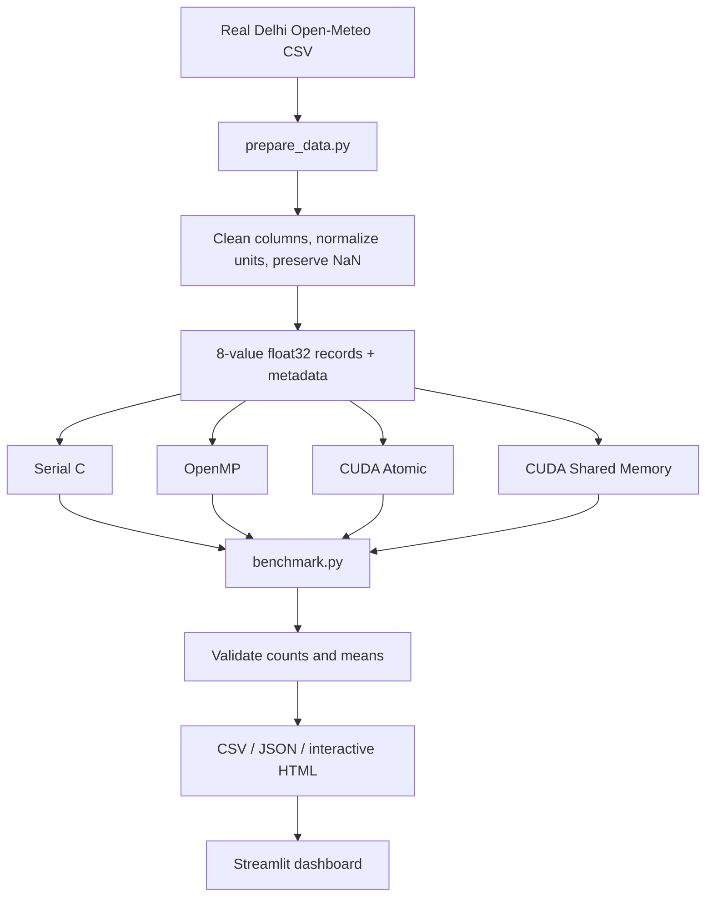

# 🌦️ Weather Forecasting Using High-Performance Computing (HPC)

**Real Delhi weather-data analysis with Serial C, OpenMP, NVIDIA CUDA, and an interactive Streamlit performance dashboard.**


> **Project scope:** This application performs **statistical analysis of historical weather records** and measures the acceleration obtained through high-performance computing. It is **not yet a trained, validated model for predicting future weather**. The title reflects the wider weather-forecasting application domain.

**🏁 Benchmark highlight (supplied dashboard export):** Serial C **47.250 ms** → CUDA Shared Memory **4.200 ms** (**11.25×** compute-only speedup). Eight-thread OpenMP reached **14.846 ms** (**3.18×**). See [measured performance results](#measured-performance-results) for the full table and timing limitations.

## Table of contents

1. [Overview](#overview)
2. [Main features](#main-features)
3. [Real weather dataset](#real-weather-dataset)
4. [How the system works](#how-the-system-works)
5. [Technologies and requirements](#technologies-and-requirements)
6. [Installation on Windows 11](#installation-on-windows-11)
7. [How to run each implementation](#how-to-run-each-implementation)
8. [Benchmarking and scaling experiments](#benchmarking-and-scaling-experiments)
9. [Measured performance results](#measured-performance-results)
10. [Weather analysis results](#weather-analysis-results)
11. [Streamlit dashboard](#streamlit-dashboard)
12. [Validation and testing](#validation-and-testing)
13. [Project structure](#project-structure)
14. [Exports](#exports)
15. [Troubleshooting](#troubleshooting)
16. [Limitations and future work](#limitations-and-future-work)
17. [References and acknowledgements](#references-and-acknowledgements)

---

## Overview

Analyzing long-term meteorological datasets requires the same calculations to be repeated over many observations and variables. This project compares four implementations of **the same eight-parameter statistical workload**:

| Implementation | Processing hardware | Approach |
|---|---|---|
| **Serial C** | CPU, one thread | Sequential scan; reference result and baseline time |
| **OpenMP** | Multicore CPU | Parallel loop with thread-local reductions and merging |
| **CUDA Atomic** | NVIDIA GPU | Threads accumulate into global sums, squares, and counts using atomics |
| **CUDA Shared Memory** | NVIDIA GPU | Threads reduce values inside blocks before fewer global atomic updates |

For each weather parameter, the programs calculate the **valid observation count, sum, sum of squares, mean, and population standard deviation**. A Python benchmark runner checks the parallel results against Serial C, collects repeat measurements, and produces interactive plots with Streamlit.

The project runs natively on **Windows 11 through Visual Studio Code's PowerShell terminal**, with GPU acceleration tested on an **NVIDIA GeForce GTX 1650**.

## Main features

- **Genuine historical Delhi weather data** imported from Open-Meteo CSV; no artificial temperature grids or fabricated records in the benchmarking pipeline.
- **Eight meteorological parameters:** temperature, relative humidity, dew point, apparent temperature, precipitation, rainfall, snowfall, and wind speed.
- **Serial C baseline** and configurable **OpenMP** CPU thread counts (for example, 1, 2, 4, and 8).
- **Two different CUDA kernels:** global atomic accumulation and shared-memory/block reduction.
- **Matched inputs and output validation** across CPU and GPU methods, including missing-value checks.
- **Execution time, compute-only speedup, GPU transfer-inclusive timing, and OpenMP efficiency**.
- **Strong scaling:** hold the number of actual input rows fixed and vary the OpenMP thread count.
- **Dataset-size scaling:** analyze progressively larger *real* subsets of the CSV, including its full usable size.
- **Repeat benchmarking** with median timings to reduce the impact of unusual individual runs.
- **Streamlit dashboard** with readable charts, weather statistics, historical trends, validation details, and downloads.
- **CSV, JSON, and interactive HTML exports** (HTML can be printed to PDF).
- **Windows setup checker, automated tests, and one-command demonstration script**.

## Real weather dataset

**Provider:** [Open-Meteo Historical Weather API](https://open-meteo.com/en/docs/historical-weather-api)  
**Geographic area:** New Delhi, India; approximately **28.576448° N, 77.186780° E**, elevation approximately **214 m**  
**Time zone:** `Asia/Kolkata`  
**Historical coverage:** the current project dashboard is labelled **2010–2025**. The **actual first/last timestamps and record count must be read from your current CSV**—not from a manually edited dashboard heading.

Open-Meteo historical products are **model-derived/reanalysis-based geographic weather data**; they should not automatically be described as direct measurements from a specific physical weather station.

### Eight analyzed parameters

| # | Weather parameter | Typical Open-Meteo CSV column | Analysis unit |
|---:|---|---|---|
| 1 | Air temperature | `temperature_2m (°C)` | °C |
| 2 | Relative humidity | `relative_humidity_2m (%)` | % |
| 3 | Dew point | `dew_point_2m (°C)` | °C |
| 4 | Apparent temperature | `apparent_temperature (°C)` | °C |
| 5 | Precipitation | `precipitation (mm)` | mm per hourly record |
| 6 | Rainfall | `rain (mm)` | mm per hourly record |
| 7 | Snowfall | `snowfall (cm)` | cm per hourly record |
| 8 | Wind speed at 10 m | `wind_speed_10m (km/h)` | **m/s**, converted from km/h |

**Preprocessing rules:**

1. Detect the original header (Open-Meteo CSV downloads commonly contain **three metadata/blank lines** before the tabular header).
2. Resolve recognized columns by their names, rather than assuming a fixed column position.
3. Convert numerical values to a consistent **eight-column, row-major float32** representation.
4. Convert wind speed from **km/h to m/s** using `wind_speed_m_s = wind_speed_km_h / 3.6` where appropriate.
5. Preserve missing or invalid values as `NaN`; calculations **skip missing values**, not replace them with fabricated zeros.
6. Keep only records with at least one usable analyzed value, and record exactly how many rows were skipped.
7. Save `data/prepared_delhi.f32` and `data/prepared_delhi.json` for consistent CPU/GPU analysis.

**Important record-count note:** A continuous **single-location, once-per-hour** series from **1 January 2010 through 31 December 2025** would contain **140,256 timestamps** before considering duplicates or gaps. A manually entered dashboard label of **400,256 records** is not proof of 400,256 distinct hourly observations. Use `rows_csv`, `rows_used`, and `first_timestamp` / `last_timestamp` from the preprocessing metadata as authoritative project counts. If the CSV contains a different time span or multiple locations, describe that explicitly.

### Obtaining and configuring the CSV

1. Visit [Open-Meteo Historical Weather](https://open-meteo.com/en/docs/historical-weather-api).
2. Use the Delhi coordinates and select the date range, such as **2010-01-01 to 2025-12-31**, and the eight fields above.
3. Export **hourly data as CSV** and place it in `data/`.
4. Open `scripts/prepare_data.py` and ensure the `FILES` dictionary points to the exact downloaded filename, for example:

```python
FILES = {
    'delhi': 'YOUR_EXACT_DELHI_CSV_FILENAME.csv',
    'historical': 'merged_weather_data_2019_2024.csv',
    'cities2025': 'India_70_Cities_weather_2025_Final.csv',
}
```

The earlier working file was called `open-meteo-28.58N77.19E214m(2).csv`; **use the actual name of your current 2010–2025 download instead**. Keep the dataset key `'delhi'` unchanged because other scripts refer to that key. If you change the filename, also update `scripts/check_setup.py` if it still checks the old name.

The project's `.gitignore` intentionally excludes `data/*.csv`, prepared binary data, and generated benchmark outputs. **A GitHub clone therefore needs its own CSV download**, unless you separately choose to publish an appropriately licensed dataset.

## How the system works



### Mathematical workload

For each weather parameter \(j\), using only its \(C_j\) finite observations:

$$
S_j = \sum_{i\ \mathrm{valid}} x_{ij}, \qquad
Q_j = \sum_{i\ \mathrm{valid}} x_{ij}^{2}
$$

$$
\mu_j = \frac{S_j}{C_j}, \qquad
\sigma_j = \sqrt{\max\!\left(0, \frac{Q_j}{C_j}-\mu_j^{2}\right)}
$$

If \(C_j=0\), the mean and standard deviation are **unavailable**, not zero. The same formulas are implemented in all four execution methods. Small floating-point differences are possible because parallel reductions can add values in a different order.

**CUDA implementation detail:** The atomic kernel performs global atomic updates for valid values. The shared-memory kernel uses 256-thread blocks to combine values by their eight parameter positions before issuing fewer global atomic updates. This reduces contention; it does not guarantee the GPU is always faster for every dataset size.

## Technologies and requirements

| Technology | Use |
|---|---|
| Windows 11 | Development and benchmarking OS |
| [VS Code](https://code.visualstudio.com/download) | Editor and PowerShell terminal |
| [Python](https://www.python.org/downloads/windows/) | Preprocessing, automation, tests, dashboard |
| [Visual Studio C++ tools](https://visualstudio.microsoft.com/visual-cpp-build-tools/) | MSVC compiler (`cl.exe`), Windows SDK, OpenMP |
| [NVIDIA CUDA Toolkit](https://developer.nvidia.com/cuda-toolkit-archive) | GPU compilation (`nvcc`), CUDA kernels |
| NVIDIA GeForce GTX 1650 | Demonstrated GPU, CUDA target `sm_75` |
| NumPy and Pandas | CSV preprocessing and statistics handling |
| Plotly and Streamlit | Interactive performance/meteorological visualizations |
| Git | Repository cloning and version control (optional once downloaded) |

### Known working Windows configuration

- **Operating system:** Windows 11
- **Editor:** Visual Studio Code (blue VS Code)
- **GPU:** NVIDIA GeForce GTX 1650 laptop GPU
- **CUDA:** 13.2 (`nvcc -arch=sm_75`)
- **Host compiler:** **MSVC toolset 14.44**, installed alongside Visual Studio 2026
- **Python:** Python 3.14.7 was used successfully for the dashboard dependencies

**Compiler compatibility:** CUDA 11.7 rejected the Visual Studio 2026 host compiler. CUDA 13.2 fixed the version mismatch, but `cudafe++` initially crashed with a newer MSVC compiler; using **MSVC 14.44** allowed the CUDA project to build. The supplied `scripts/build.cmd` selects 14.44 when installed. This is a **project-specific known-good combination**, not a guarantee for every future Toolkit/compiler version.

## Installation on Windows 11

All commands below are for the **VS Code PowerShell terminal**. Run them **from the folder containing `dashboard.py`, `src/`, `scripts/`, and `requirements.txt`** (usually `windows_hpc/`).

### 1. Clone or download the repository

```powershell
# Replace YOUR_USERNAME and YOUR_REPO with the actual GitHub address.
git clone https://github.com/YOUR_USERNAME/YOUR_REPO.git
cd YOUR_REPO

# Only if the repository has a nested windows_hpc folder:
cd windows_hpc

code .
```

If your repository root itself contains `dashboard.py` and `scripts/`, **do not run** `cd windows_hpc`.

### 2. Install required desktop tools

- Install **Python** and ensure `py` works in PowerShell.
- Install **Visual Studio Community / C++ Build Tools** with **Desktop development with C++** and the Windows SDK.
- Install the **MSVC 14.44 toolset**, available through the Visual Studio Installer's individual components.
- Install the **NVIDIA driver** and **CUDA Toolkit 13.2** for GPU builds.
- Install VS Code extensions **C/C++** and **Python** (optional but recommended).

Verify:

```powershell
py --version
nvidia-smi
nvcc --version
```

`nvidia-smi` detects the GPU/driver; `nvcc --version` identifies the **installed compiler toolkit**.

### 3. Create the Python environment

```powershell
py -m venv .venv
.\.venv\Scripts\python.exe -m pip install --upgrade pip
.\.venv\Scripts\python.exe -m pip install -r requirements.txt
```

These commands do not require activating the virtual environment. If it already exists, you can simply use its `python.exe`.

### 4. Add and prepare your real Delhi CSV

Put the original Open-Meteo download inside `data/`, update `FILES['delhi']` in `scripts/prepare_data.py` if necessary, then execute:

```powershell
.\.venv\Scripts\python.exe scripts\prepare_data.py --dataset delhi --force
```

`--force` regenerates the prepared binary and metadata after replacing the CSV. The script reports **real CSV rows**, **usable rows**, **skipped rows**, and all recognized column mappings. **Do not use** the legacy `scripts/generate_data.py` for this real-data experiment.

### 5. Check the software setup and build

```powershell
.\.venv\Scripts\python.exe scripts\check_setup.py
.\scripts\build.cmd
Get-ChildItem .\build\
```

Expected Windows executables:

```text
build/
├── weather_serial.exe
├── weather_omp.exe
└── weather_cuda.exe
```

If `nvcc` is missing, the build script can still create the two CPU executables; run benchmarks with `--cuda off`.

### 6. Run tests, benchmark, and dashboard

```powershell
.\.venv\Scripts\python.exe -m unittest discover -s tests -v

.\.venv\Scripts\python.exe scripts\benchmark.py --datasets delhi --rows 1000 10000 50000 100000 --passes 20 --threads 1 2 4 8 --repeats 5 --cuda on

.\.venv\Scripts\python.exe -m streamlit run dashboard.py
```

Open **http://localhost:8501** in your browser.

> **Dataset replacement and tests:** Some original tests were written specifically for the earlier **2019–2025** download and assert its first/last timestamps. If you switched to a **2010–2025** file, update those fixture-specific timestamp expectations in `tests/test_project.py` to match the new CSV. Keep the essential numerical consistency tests intact.

### One-command demo

After installing the Python dependencies and making sure the CSV path is correct:

```powershell
powershell -NoProfile -ExecutionPolicy Bypass -File .\scripts\run_demo.ps1
```

For a CPU-only demonstration:

```powershell
powershell -NoProfile -ExecutionPolicy Bypass -File .\scripts\run_demo.ps1 -CpuOnly
```

The demo checks setup, builds programs, prepares the CSV, runs tests, benchmarks, and launches Streamlit. If you replaced the CSV, run `prepare_data.py --force` beforehand.

## How to run each implementation

Replace `N` with a **real row count not exceeding `rows_used`** in `data/prepared_delhi.json`. The example below uses 50,000 actual observations.

```powershell
# Serial C — 1 CPU thread
.\build\weather_serial.exe --input data\prepared_delhi.f32 --rows 50000 --passes 20

# OpenMP — 1, 2, 4, or 8 CPU threads
.\build\weather_omp.exe --input data\prepared_delhi.f32 --rows 50000 --passes 20 --threads 8

# CUDA Atomic — GPU
.\build\weather_cuda.exe --input data\prepared_delhi.f32 --rows 50000 --passes 20 --variant atomic

# CUDA Shared Memory — GPU
.\build\weather_cuda.exe --input data\prepared_delhi.f32 --rows 50000 --passes 20 --variant shared
```

Each program prints JSON with its method, row count, number of analysis passes, compute timing, and eight-element arrays of valid counts, means, and standard deviations. The CUDA executable additionally reports the device name and transfer-inclusive timing.

## Benchmarking and scaling experiments

### Compare all four methods

```powershell
.\.venv\Scripts\python.exe scripts\benchmark.py --datasets delhi --rows 1000 10000 50000 100000 --passes 20 --threads 1 2 4 8 --repeats 5 --cuda on
```

Options:

| Argument | Meaning |
|---|---|
| `--datasets delhi` | Use the configured Delhi CSV |
| `--rows 1000 10000 50000 100000` | Test **real prefixes** of that many rows, where available |
| `--passes 20` | Repeat the same analysis 20 times per invocation to obtain a measurable workload |
| `--threads 1 2 4 8` | Compare OpenMP thread counts |
| `--repeats 5` | Execute each configuration five times; summarize using the median |
| `--cuda on` | Require both CUDA variants; fail if the GPU executable is missing |
| `--cuda off` | CPU-only benchmarking |
| `--cuda auto` | Use CUDA if the executable is available |
| `--force-preprocess` | Re-read and rebuild the prepared CSV data |

The benchmark **automatically includes the entire number of usable rows**, and ignores requested row sizes larger than the actual dataset. It **never pads the dataset or generates extra weather observations**. Repeating the analysis with `--passes` increases the compute workload; it does **not** increase the number of unique timestamps.

### Strong scaling

Hold `--rows` and `--passes` fixed; change only the number of OpenMP threads. Ideally measure a sufficiently large workload, and avoid unnecessary background tasks while benchmarking.

### Dataset-size scaling

Compare `1,000`, `10,000`, `50,000`, `100,000`, and the full original CSV **when those sizes exist**. A larger input will not always yield a proportionally larger speedup, particularly for GPU kernels with launch and transfer overhead.

### Performance equations

For a given input size and number of passes:

```text
Compute speedup = Serial C compute time / Parallel compute time
OpenMP efficiency = Compute speedup / OpenMP thread count
OpenMP efficiency (%) = 100 × OpenMP efficiency
```

CUDA **does not** use OpenMP's CPU-thread efficiency formula. Report GPU kernel-only performance and transfer-inclusive performance separately.

## Measured performance results

The following numbers are from the project's **22 November 2026 Streamlit benchmark PDF export**, with **20 analysis passes** and the **median of five runs**. These are **compute-only measurements** on the project laptop, **not guaranteed timings for other machines**.

| Method | Compute time (ms) | Speedup vs Serial C |
|---|---:|---:|
| Serial C | **47.250** | **1.00×** |
| OpenMP — 1 CPU thread | 39.536 | 1.20× |
| OpenMP — 2 CPU threads | 22.395 | 2.11× |
| OpenMP — 4 CPU threads | 17.200 | 2.75× |
| OpenMP — 8 CPU threads | **14.846** | **3.18×** |
| CUDA Atomic | 34.625 | 1.36× |
| **CUDA Shared Memory** | **4.200** | **11.25×** |

**Main observation:** CUDA Shared Memory was fastest in this measured configuration—approximately **11.25 times** the Serial C compute performance, or a **91.1% compute-time reduction**. OpenMP with eight threads achieved approximately **3.18×** speedup and **39.8%** parallel efficiency. CUDA Atomic was slower than eight-thread OpenMP in this experiment.

> **Interpretation and reproducibility:** The exported dashboard had been manually labelled with **400,256 records**. That number was **not independently verified against the raw 2010–2025 CSV**. Treat the table above as *the timings shown in the supplied dashboard export*, not as proof that 400,256 unique weather timestamps were analyzed. Re-run the benchmark against your checked-in configuration to reproduce results for your actual current CSV. GPU host–device transfer is excluded from the `compute_ms` speedups shown here; compare `total_ms` separately for the broader GPU processing cost.

## Weather analysis results

The supplied weather-analysis dashboard export displayed the following **approximate full-dataset averages** (rounded to two decimal places). They are included as **previous dashboard outputs**, not substitutes for checking the latest source CSV.

| Parameter | Average shown | Unit |
|---|---:|---|
| Temperature | 24.58 | °C |
| Relative humidity | 61.83 | % |
| Dew point | 15.23 | °C |
| Apparent temperature | 25.72 | °C |
| Precipitation | 0.08 | mm per hourly record |
| Rainfall | 0.08 | mm per hourly record |
| Snowfall | 0.00 | cm per hourly record |
| Wind speed | 2.54 | m/s |

For monthly trends, the dashboard uses **monthly averages** for temperature, humidity, dew point, apparent temperature and wind speed, and **monthly totals** for precipitation, rainfall and snowfall. A zero value for snowfall is different from a missing snowfall reading.

## Streamlit dashboard

Start it with:

```powershell
.\.venv\Scripts\python.exe -m streamlit run dashboard.py
```

Open **http://localhost:8501**.

The dashboard presents:

- **Real Delhi weather measurements** with mean values, valid counts, missing-data coverage, and original historic time-series trends.
- **Execution & speedup** charts comparing Serial C, OpenMP, and CUDA implementations.
- **HPC scaling** plots showing thread-count scaling, parallel efficiency, and performance versus authentic CSV row count.
- **Files, validation & exports** showing source mappings, data provenance, and downloadable benchmark results.

The charts deliberately use **dark axis labels on a light plot background** so they remain legible in Streamlit's dark theme and in HTML/PDF printouts.

## Validation and testing

The system is designed to compare **identical numeric inputs** for each execution strategy. The benchmark checks:

- Exactly **eight result positions** for each weather parameter.
- Equal **valid observation counts** across implementations.
- Agreement of mean values within the configured floating-point tolerance (small summation-order differences are expected).
- A corresponding Serial C baseline for each dataset size.

The test suite is run with:

```powershell
.\.venv\Scripts\python.exe -m unittest discover -s tests -v
```

**Dataset-specific test warning:** The original unit test includes first/last-timestamp assertions for an earlier Open-Meteo CSV. When using another download, review and update those expectations without removing algorithmic correctness tests.

### Timing boundaries

- **Serial C / OpenMP `compute_ms`:** timed in-memory weather analysis, excluding CSV parsing and binary file I/O.
- **CUDA `compute_ms`:** GPU resets, kernel launches, and device computation, **excluding** host-to-device and device-to-host copies.
- **CUDA `total_ms`:** measured transfer-inclusive processing around the device copies and computation, but excludes CSV parsing and GPU allocation overhead.
- **CPU `total_ms`:** currently the CPU compute time; it is **not an end-to-end disk-to-result measurement**.

Because of these different boundaries, **CPU and CUDA `total_ms` should not be labelled identical full-application end-to-end timings**.

## Project structure

```text
windows_hpc/
├── dashboard.py                 # Streamlit weather + HPC visualizations
├── requirements.txt             # NumPy, Pandas, Plotly, Streamlit
├── .gitignore
├── README.md
├── MENTOR_DEMO.md
├── data/
│   ├── .gitkeep
│   ├── column_map.example.json
│   ├── YOUR_DELHI_WEATHER.csv    # Download separately (gitignored)
│   ├── prepared_delhi.f32       # Generated binary (gitignored)
│   └── prepared_delhi.json      # Dataset metadata (gitignored)
├── src/
│   ├── weather_cpu.c            # Shared Serial C / OpenMP implementation
│   └── weather_cuda.cu          # CUDA Atomic + Shared Memory kernels
├── scripts/
│   ├── build.cmd                # MSVC + nvcc native build
│   ├── check_setup.py           # Verify Windows tools, packages and input
│   ├── prepare_data.py          # Real CSV preprocessing
│   ├── benchmark.py             # Timings, validation, scaling, exports
│   └── run_demo.ps1             # End-to-end Windows demonstration
├── tests/
│   └── test_project.py          # Real-data and native correctness checks
├── build/                       # Generated .exe files (gitignored)
└── results/                     # Generated reports (gitignored)
    ├── raw_runs.csv
    ├── summary.csv
    ├── parameter_stats.csv
    ├── summary.json
    └── dashboard.html
```

The older repository copy may still contain a legacy `scripts/generate_data.py` from the original synthetic-grid benchmark. **It is not used in this real-weather analysis workflow.**

## Exports

| File | Contents |
|---|---|
| `results/raw_runs.csv` | Every individual timing trial |
| `results/summary.csv` | Median compute time, transfer-inclusive time, speedup, thread efficiency, dataset size |
| `results/parameter_stats.csv` | Eight-variable means, standard deviations, valid counts, missing counts, and coverage |
| `results/summary.json` | Benchmark configuration and original-source metadata |
| `results/dashboard.html` | Interactive plots and tables readable in a browser |

The Streamlit dashboard provides buttons to download the CSV/JSON/HTML outputs. To create a PDF report, open the generated HTML report in Chrome or Edge, press **Ctrl + P**, and choose **Save as PDF**.

## Troubleshooting

<details>
<summary><strong><code>.venv\Scripts\python.exe</code> is not recognized</strong></summary>

The virtual environment does not exist in the current project directory, or you are running PowerShell from the wrong folder.

```powershell
py -m venv .venv
.\.venv\Scripts\python.exe -m pip install -r requirements.txt
```

</details>

<details>
<summary><strong>The original Open-Meteo CSV cannot be found</strong></summary>

Place the CSV inside `data/`. Change `FILES['delhi']` in `scripts/prepare_data.py` to the exact file name (including spaces or parentheses), then run:

```powershell
.\.venv\Scripts\python.exe scripts\prepare_data.py --dataset delhi --force
```

If the file name changed, update any old name hardcoded in `scripts/check_setup.py` too.

</details>

<details>
<summary><strong><code>ValueError: assignment destination is read-only</code></strong></summary>

With newer NumPy/Pandas versions, the `prepare_data.py` numeric array must be writable. In the parameter-processing section, use:

```python
arr = series.to_numpy(dtype=np.float64, na_value=np.nan, copy=True)
arr[~np.isfinite(arr)] = np.nan
```

The `copy=True` change fixes this error without altering the source CSV.

</details>

<details>
<summary><strong>CUDA 11.7 reports an unsupported Microsoft Visual Studio compiler</strong></summary>

This project was built successfully with **CUDA 13.2** and **MSVC 14.44**. Check:

```powershell
nvcc --version
```

Use a compatible Toolkit/compiler combination; do not rely on `-allow-unsupported-compiler` as the primary fix.

</details>

<details>
<summary><strong><code>cudafe++</code> crashes with <code>0xC0000005</code></strong></summary>

This occurred when CUDA 13.2 selected a newer MSVC toolset. Install **MSVC 14.44** using Visual Studio Installer, then allow `scripts/build.cmd` to select it (or configure `HPC_MSVC_VERSION`). The working build showed:

```text
Selected MSVC: 14.44.35207
=== Building serial CPU ===
=== Building OpenMP CPU ===
=== Building CUDA for GTX 1650 [sm_75] ===
=== Build finished: .\build\ ===
```

</details>

<details>
<summary><strong>Serial/OpenMP runs, but <code>weather_cuda.exe</code> is missing</strong></summary>

CUDA did not compile or `nvcc` is not on PATH. Check `nvcc --version`, install/repair the Toolkit and MSVC toolset, and rerun `scripts\build.cmd`. Until then, use `--cuda off` in the benchmark.

</details>

<details>
<summary><strong>Dashboard is empty or has older grid-based results</strong></summary>

Run the **current real-CSV** `prepare_data.py` and `benchmark.py` to regenerate `results/summary.csv`, `parameter_stats.csv`, and `summary.json`, then restart Streamlit. Do not mix the old synthetic-grid exports with the real-CSV dashboard.

</details>

<details>
<summary><strong>Automated test fails because the CSV now starts in 2010</strong></summary>

The earlier test fixture assumed a 2019–2025 source file. Update the explicit date assertions in `tests/test_project.py` to match the new input. Retain checks for column mappings, unit conversion, file size, Serial/OpenMP agreement, and CUDA agreement.

</details>

## Limitations and future work

**Current limitations**

- Historical statistical analysis is implemented, **not** trained next-day weather forecasting.
- The reported speedup depends on workload size, machine, thread count, thermals, and the boundary used for timing.
- Single-location hourly records have a finite size; large benchmark row counts must not be achieved by inventing or repeating timestamps.
- The published dashboard screenshot had a manually changed record-count label; readers should verify counts from source CSV metadata.
- Benchmark outputs are locally generated and excluded by `.gitignore` unless deliberately exported and published.

**Possible improvements**

- Add a validated 1–24-hour temperature forecasting model using a chronological train/validation/test split, plus MAE/RMSE.
- Measure true end-to-end CSV-load-to-result times and separately chart PCIe transfer costs.
- Add confidence intervals, throughput, CPU utilization, and GPU utilization in benchmark reports.
- Add verified multi-location Delhi NCR data for regional comparisons.
- Compare additional CUDA reduction strategies and investigate when GPU overhead outweighs parallel benefits.

## References and acknowledgements

- [Open-Meteo — Historical Weather API](https://open-meteo.com/en/docs/historical-weather-api): source of the historical weather data.
- [OpenMP Specification](https://www.openmp.org/specifications/): shared-memory CPU parallel programming.
- [NVIDIA CUDA C++ Programming Guide](https://docs.nvidia.com/cuda/cuda-c-programming-guide/): CUDA execution, atomics and shared memory.
- [NVIDIA CUDA Best Practices Guide](https://docs.nvidia.com/cuda/cuda-c-best-practices-guide/): GPU benchmarking and optimization.
- [Streamlit Documentation](https://docs.streamlit.io/): interactive dashboard framework.
- [Plotly Python Documentation](https://plotly.com/python/): interactive performance/weather visualizations.
- [Original reference repository: Asha21697/weather-forecasting-openmp-mpi](https://github.com/Asha21697/weather-forecasting-openmp-mpi): initial weather-analysis/HPC project reference. The Windows Serial/OpenMP/CUDA/Streamlit workflow documented here is a separate adaptation and extension.

**Academic project:** M.Tech Computer Science and Engineering, Jaypee Institute of Information Technology, Noida.  
**Implementation and integration:** Aryan Choudhary.

---

*Benchmarks are measurements, not promises: use the scripts above to obtain fresh results on your own hardware and dataset.*
