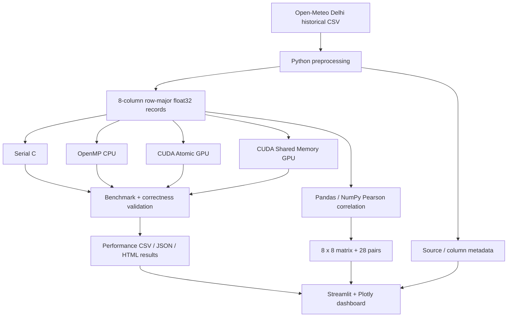

# 🌦️ Weather Forecasting Using High-Performance Computing (HPC)

**Real historical weather analysis for New Delhi using Serial C, OpenMP, NVIDIA CUDA, Pearson correlation, and an interactive Streamlit dashboard.**


> **Scientific scope:** Despite the project title, the implemented application analyzes **historical weather records**, quantifies **CPU/GPU computation performance**, and explores **correlations between meteorological variables**. It does **not** currently train a model that forecasts tomorrow's weather or report forecast-prediction accuracy.

## Project at a glance

| Item | Description |
|---|---|
| Project domain | Weather-data analytics and High-Performance Computing (HPC) |
| Location | New Delhi, India (approximately 28.576448° N, 77.186780° E) |
| Source | [Open-Meteo Historical Weather API](https://open-meteo.com/en/docs/historical-weather-api) |
| Time zone | Asia/Kolkata |
| Period shown in current dashboard | 2010–2025; verify exact timestamps against the local CSV |
| Meteorological variables | **8** |
| Execution methods | **4**: Serial C, OpenMP, CUDA Atomic, CUDA Shared Memory |
| Correlation method | Pairwise **Pearson product–moment correlation** (Pandas/NumPy) |
| Correlation comparisons | **8 × 8 matrix; 28 distinct cross-parameter pairs** |
| Dashboard | Streamlit + Plotly, with the original dark navy/teal theme |
| Tested project GPU | NVIDIA GeForce GTX 1650 (`sm_75`) |
| Development environment | Windows 11, VS Code, MSVC C compiler, NVIDIA CUDA Toolkit |

A continuous one-location hourly series from **2010-01-01 through 2025-12-31** contains **140,256 possible timestamps** (including leap days). That is also the number shown in the recent dashboard screenshot. Actual source rows, missing timestamps, and usable records should always be confirmed from `data/prepared_delhi.json` or `results/summary.json`, rather than inferred from a heading.

---

## Table of contents

1. [Overview and objectives](#overview-and-objectives)
2. [Key features](#key-features)
3. [System architecture](#system-architecture)
4. [Dataset and preprocessing](#dataset-and-preprocessing)
5. [HPC computation and algorithms](#hpc-computation-and-algorithms)
6. [New feature: correlation between eight parameters](#new-feature-correlation-between-eight-parameters)
7. [Interactive dashboard](#interactive-dashboard)
8. [Technology stack and requirements](#technology-stack-and-requirements)
9. [Install and run on Windows 11](#install-and-run-on-windows-11)
10. [Run the native algorithms](#run-the-native-algorithms)
11. [Benchmark methodology and measured results](#benchmark-methodology-and-measured-results)
12. [Correlation calculation and interpretation](#correlation-calculation-and-interpretation)
13. [Validation and reproducibility](#validation-and-reproducibility)
14. [Project structure](#project-structure)
15. [Output files and sharing](#output-files-and-sharing)
16. [Troubleshooting](#troubleshooting)
17. [Limitations and future improvements](#limitations-and-future-improvements)
18. [References and acknowledgements](#references-and-acknowledgements)

---

## Overview and objectives

Meteorological datasets contain many measurements over time. Even simple operations become computationally relevant when performed repeatedly on large inputs or across multiple parallel configurations. This project investigates the performance of **statistical reductions over real hourly weather observations**, using a common workload for four CPU/GPU implementations.

The major objectives are to:

- Process an authentic Delhi historical weather CSV, rather than create synthetic weather grids.
- Calculate valid counts, means and population standard deviations for eight parameters.
- Implement and compare Serial C, multi-threaded OpenMP, CUDA global atomic reduction and CUDA shared-memory reduction.
- Verify that the execution methods produce numerically consistent results from identical inputs.
- Measure execution time, speedup, CPU-thread efficiency and scaling over real input sizes.
- **Analyze how all eight meteorological parameters relate to each other using Pearson correlation**, with a complete matrix and interactive graphics.
- Present the results through a readable Streamlit application.

This project combines two complementary kinds of analysis:

1. **HPC benchmarking** asks *how quickly* each implementation computes the weather statistics.
2. **Weather correlation analysis** asks *how strongly* two measured weather variables vary together.

The correlation module is an **additional Pandas/NumPy-based analysis**. It is **not** currently another CUDA kernel, and its runtime must not be included in the reported CUDA speedups.

## Key features

- Actual Open-Meteo hourly weather records, with source provenance and unit handling.
- Eight-variable summary statistics: mean, standard deviation, valid count, and coverage.
- Native C single-thread reference implementation.
- OpenMP execution with configurable CPU threads (e.g., 1, 2, 4, 8).
- Two CUDA reduction strategies: global atomics and block-level shared memory.
- Automatic numerical comparison of parallel results with the Serial C baseline.
- Repeated benchmarks summarized with median timings.
- Strong-scaling and dataset-size-scaling plots.
- Interactive dark-navy Streamlit dashboard, retaining its original style.
- **Complete eight-variable Pearson correlation matrix, 28 unique parameter-pair comparisons, ranked correlations, scatter explorer and correlation CSV downloads.**
- Handling of unavailable, nonfinite, missing, or constant-valued weather parameters without inventing readings.

## System architecture



**Separate processing branches:** The C/OpenMP/CUDA engines compute single-variable summary statistics, while the correlation module reads the same real prepared weather rows (or reconstructs them from the CSV when necessary) and computes pairwise relationships. Both are displayed in the same Streamlit application.

## Dataset and preprocessing

### Source and eight weather parameters

The current dashboard is configured for the **New Delhi Open-Meteo historical weather dataset**, labelled **2010–2025**. Open-Meteo's historical weather service supplies location-based **model-derived / reanalysis-type historical weather data**; it should not automatically be described as measurements from one physical weather station.

| # | Internal variable | Display name | Original Open-Meteo field (typical) | Analysis unit |
|---:|---|---|---|---|
| 1 | `temperature` | Temperature | `temperature_2m (°C)` | °C |
| 2 | `relative_humidity` | Relative Humidity | `relative_humidity_2m (%)` | % |
| 3 | `dew_point` | Dew Point | `dew_point_2m (°C)` | °C |
| 4 | `apparent_temperature` | Apparent Temperature | `apparent_temperature (°C)` | °C |
| 5 | `precipitation` | Precipitation | `precipitation (mm)` | mm per hourly record |
| 6 | `rainfall` | Rainfall | `rain (mm)` | mm per hourly record |
| 7 | `snowfall` | Snowfall | `snowfall (cm)` | cm per hourly record |
| 8 | `wind_speed` | Wind Speed | `wind_speed_10m (km/h)` | **m/s** after conversion |

The original data may include more columns, but these are the **eight variables actually processed by the project**. The mapping depends on the input CSV headers and is recorded in the generated metadata.

### Preprocessing procedure

The script `scripts/prepare_data.py`:

1. Reads the Open-Meteo CSV, handling preliminary metadata lines if present.
2. Maps source column names to the eight canonical internal variables.
3. Converts each weather field to numeric data; invalid/missing values become `NaN`.
4. Converts wind speed from **km/h to m/s** when required (`wind_speed_ms = wind_speed_kmh / 3.6`).
5. Preserves valid zero measurements, such as genuinely zero snowfall.
6. Removes a record only when **all eight** analyzed measurements are missing.
7. Writes a contiguous row-major binary array of **eight float32 values per retained record**, plus source metadata.

Example generated files:

```text
data/prepared_delhi.f32     # Actual prepared numerical input for C/OpenMP/CUDA
data/prepared_delhi.json    # Original CSV, timestamp coverage, mappings, counts, units
```

Each retained weather record takes `8 × 4 = 32 bytes` in the `.f32` matrix, excluding metadata. Missing measurements remain distinguishable as `NaN`.

**Input consistency:** The correlation dashboard prefers `prepared_delhi.f32` when it is current and matches the benchmark metadata. Otherwise it rebuilds the same eight-column numerical representation from the source CSV. It does **not** create fake extra weather records to fill a requested size.

### Obtain the CSV yourself

1. Open [Open-Meteo Historical Weather](https://open-meteo.com/en/docs/historical-weather-api).
2. Select the Delhi coordinates and the requested date interval, e.g. **2010-01-01 to 2025-12-31**, with hourly variables matching the table above.
3. Download the **CSV** and place it in your project's `data/` directory.
4. In `scripts/prepare_data.py`, update the value for `FILES['delhi']` to match the **exact filename** you downloaded.

For example:

```python
FILES = {
    'delhi': 'YOUR_DELHI_OPEN_METEO_FILE.csv',
    'historical': 'merged_weather_data_2019_2024.csv',
    'cities2025': 'India_70_Cities_weather_2025_Final.csv',
}
```

The earlier project source used `open-meteo-28.58N77.19E214m(2).csv`, covering **2019-01-05 to 2025-12-19**. That **earlier file is not the 2010–2025 file** shown in the current dashboard. Do not combine correlation coefficients calculated from one coverage interval with benchmark or weather records from another without identifying the difference.

## HPC computation and algorithms

### 1. Serial C

Sequentially scans the prepared weather rows, accumulating eight independent sums, sums of squares, and valid counts. This is the **correctness baseline** and reference execution time.

### 2. OpenMP

Divides input records across CPU worker threads. Thread-local partial statistics are combined through reductions. Varying the thread count shows the benefit and overhead of CPU parallelism.

### 3. CUDA Atomic

GPU threads process weather observations and update global accumulators using atomic operations. This is a straightforward GPU implementation, but many updates to the same variables can increase contention.

### 4. CUDA Shared Memory

Threads aggregate partial results inside CUDA blocks, then make fewer global updates. It illustrates how changing the reduction strategy can substantially improve measured GPU performance.

### Common statistical formulas

For a weather parameter `j`, considering only its `C_j` valid observations:

$$
S_j=\sum_{i\in\mathrm{valid}(j)}x_{ij},\qquad
Q_j=\sum_{i\in\mathrm{valid}(j)}x_{ij}^{2}
$$

$$
\mu_j=\frac{S_j}{C_j},\qquad
\sigma_j=\sqrt{\max\left(0,\frac{Q_j}{C_j}-\mu_j^2\right)}
$$

The reported standard deviation is the **population standard deviation**. If `C_j = 0`, the average and standard deviation are unavailable, not zero. Parallel reduction order may introduce small floating-point differences, so validity is checked with an appropriate numerical tolerance.

## New feature: correlation between eight parameters

A dedicated **Correlation** tab was added directly after **Real weather measurements**. It reveals linear relationships among every pair of the eight historical weather variables.

### What is measured?

For variables `X` and `Y`, the dashboard computes the **Pearson correlation coefficient**:

$$
r_{XY}=\frac{\sum_{i=1}^{n}(x_i-\bar{x})(y_i-\bar{y})}
{\sqrt{\sum_{i=1}^{n}(x_i-\bar{x})^2}\sqrt{\sum_{i=1}^{n}(y_i-\bar{y})^2}}
$$

Only records where **both** chosen parameters are valid are included (*pairwise deletion*). Correlation is between `−1` and `+1` when defined:

| Pearson coefficient | Interpretation |
|---|---|
| Close to `+1` | Strong positive linear association |
| Close to `−1` | Strong negative linear association |
| Close to `0` | Weak or no **linear** association |
| `N/A` / `NaN` | Undefined (e.g., constant column, insufficient matched values) |

**Correlation does not establish causation.** A coefficient close to zero does not rule out a nonlinear association.

### Why 28 parameter pairs?

Eight variables produce an **8 × 8 correlation matrix** with 64 cells (including self-correlations and mirrored pairs), but the number of *unique pairs of different parameters* is:

$$
\binom{8}{2}=\frac{8\times7}{2}=28
$$

The current Delhi dashboard has shown **21 defined pairs out of 28**. In that dataset, **snowfall is constant (zero)**, so its seven distinct pairs with other parameters have undefined Pearson correlations. The other 21 unique pairs are defined. The actual number can change if a different dataset or parameter coverage is used.

**Correct handling:** The application keeps snowfall as one of the eight parameters and marks its correlations **`N/A`**, rather than replacing mathematically undefined correlations with `0` or removing snowfall entirely.

### Visualizations in the Correlation tab

| Visualization | Functionality |
|---|---|
| **8 × 8 heatmap** | All eight parameters on both axes; annotated Pearson `r` values; positive/negative gradient; `N/A` for undefined entries; hover details include valid paired counts |
| **Correlation summary cards** | Actual observations used, defined-pair count, strongest positive coefficient, strongest negative coefficient |
| **Strongest relationships chart** | Ranked horizontal bars for positive and negative associations; select how many pairs to display |
| **Two-parameter scatter explorer** | Choose any two variables for X and Y axes; inspect actual hourly records and an optional least-squares trend line |
| **All-pairs table** | Full list of 28 unique pairs, coefficient, paired valid row count and interpretation |
| **Pairwise count matrix** | Number of records jointly available for each pair of parameters |
| **CSV download buttons** | Export the full correlation matrix and all 28 unique pairs |

**Graph interpretation:** Teal-colored bars indicate positive relationships; magenta-colored bars indicate negative relationships. Missing / constant columns are explicitly marked unavailable. Plot colors follow the dashboard's navy, blue and teal visual design.

### Scatter plot sampling is only for readability

The scatter chart can display a limited number of points (typically between **500 and 5,000**), because drawing every hourly point can clutter the display. **Pearson `r` and the fitted linear trend use all valid paired rows**, not merely the displayed sample. No interpolated or generated observations are added.

### Where is the implementation?

The new feature is **inside the main `dashboard.py`**:

| Function | Role |
|---|---|
| `load_correlation_weather()` | Loads the prepared float32 weather matrix, or reconstructs real rows from the source CSV |
| `compute_weather_correlation()` | Computes the full Pearson matrix, pairwise valid counts, 28 pair records and qualitative strength labels |
| `show_correlation_section()` | Displays the KPI cards, interactive heatmap, ranking bars, scatter explorer, data tables and CSV downloads |

A simplified version of the core computation is:

```python
# The weather DataFrame uses these exact eight columns.
columns = [
    'temperature', 'relative_humidity', 'dew_point',
    'apparent_temperature', 'precipitation', 'rainfall',
    'snowfall', 'wind_speed',
]

numeric = weather_df[columns].astype('float64')
correlation_matrix = numeric.corr(method='pearson', min_periods=3)
valid_flags = numeric.notna().astype('int64')
paired_counts = valid_flags.T.dot(valid_flags)
```

The production code additionally checks prepared-file size, freshness, source mappings and actual benchmark row counts, and handles missing/constant variables correctly.

> **Important HPC distinction:** The attached demonstration notebook inspired the correlation methodology and visual presentation, but the current project correlation tab computes **all eight real weather parameters with Pandas/NumPy**. It does **not** run the notebook's five-parameter sample matrix, perform a separate GPU correlation kernel, or claim CUDA acceleration for correlation.

## Interactive dashboard

Launch with:

```powershell
.\.venv\Scripts\python.exe -m streamlit run dashboard.py
```

Then open **http://localhost:8501**.

### Current dashboard tabs (in this exact order)

| Tab | What it displays |
|---|---|
| **⏱️ Execution & speedup** | Compute-time leaderboard, speedup comparisons and measured results table |
| **🌦️ Real weather measurements** | Weather means, standard deviations, coverage, historical monthly trends |
| **🔗 Correlation** | **NEW:** 8 × 8 correlation heatmap, 28 pairs, ranked relationships, interactive scatter plots, correlation CSV downloads |
| **📈 HPC scaling** | OpenMP CPU-thread scaling, parallel efficiency and compute time versus dataset size |
| **📁 Files, validation & exports** | Currently the **Data Integrity** view: source CSV metadata, mappings and previews; the general export/validation sections were removed from this tab |

The original design uses a **dark navy background with subtle gradients**, a blue/teal palette, metric cards, rounded graph panels and custom typography. The dashboard **does not show its former dataset-selection sidebar**: it automatically chooses **Delhi** (if available) and its **largest benchmarked real-record subset**. These are presentation-layer decisions only and do not alter the C/OpenMP/CUDA computation.

Although the final tab retains its old title, **the general “Download the measured results” and “What the experiment proves” blocks have been removed**, as requested. The correlation tab retains its **own two correlation CSV download buttons**.

## Technology stack and requirements

| Technology | Role |
|---|---|
| Windows 11 + VS Code | Development and local execution |
| C / MSVC 14.44 | Serial and OpenMP binaries |
| OpenMP | Parallel CPU reduction |
| CUDA Toolkit 13.2 + `nvcc` | GPU compilation and execution |
| NVIDIA GTX 1650 (`sm_75`) | GPU used in the project configuration |
| Python | Data preparation, automation and dashboard |
| NumPy | Float32 weather input and float64 correlation calculations |
| Pandas | CSV processing, missing-value handling, Pearson correlation and tables |
| Streamlit | Interactive user interface |
| Plotly | Heatmaps, scatter plots, bar charts and HPC performance figures |

`requirements.txt` in the project includes:

```text
numpy>=1.26
pandas>=2.2
plotly>=5.22
streamlit>=1.36
```

**Compiler note:** The tested Windows configuration used **MSVC 14.44** alongside **CUDA 13.2**. A newer MSVC toolset had previously caused `nvcc` compatibility/crash problems. `scripts/build.cmd` attempts to choose 14.44 if available; verify compatibility if using a different development environment.

## Install and run on Windows 11

Run all commands below in **VS Code PowerShell from the folder containing `dashboard.py`, `src/`, `scripts/` and `requirements.txt`** (often named `windows_hpc`).

### 1. Clone/download the repository

```powershell
git clone https://github.com/YOUR_USERNAME/YOUR_REPOSITORY.git
cd YOUR_REPOSITORY

# Only if your project files are nested in this folder:
cd windows_hpc
```

Replace the placeholders with your actual repository information. If `dashboard.py` is already in the repository root, **skip the final `cd windows_hpc`**.

### 2. Install prerequisites

Install **Python**, Visual Studio / Build Tools with **Desktop development with C++**, compatible **MSVC 14.44** tools, the **NVIDIA GPU driver**, and **CUDA Toolkit 13.2** for GPU builds.

Verify:

```powershell
py --version
nvidia-smi
nvcc --version
```

### 3. Create a Python virtual environment

```powershell
py -m venv .venv
.\.venv\Scripts\python.exe -m pip install --upgrade pip
.\.venv\Scripts\python.exe -m pip install -r requirements.txt
```

### 4. Prepare the real weather data

Put the CSV in `data/`, update its filename in `scripts/prepare_data.py`, and run:

```powershell
.\.venv\Scripts\python.exe scripts\prepare_data.py --dataset delhi --force
```

Then check the source metadata:

```powershell
Get-Content .\data\prepared_delhi.json
```

Verify `rows_used`, `first_timestamp`, `last_timestamp`, source file, and all eight mappings against the dataset you intend to present.

### 5. Compile the CPU/GPU executables

```powershell
.\.venv\Scripts\python.exe scripts\check_setup.py
.\scripts\build.cmd
Get-ChildItem .\build\
```

Expected binaries:

```text
build/weather_serial.exe
build/weather_omp.exe
build/weather_cuda.exe
```

If `nvcc` is not available, the build script can still produce the Serial and OpenMP executables; use `--cuda off` for benchmarking.

### 6. Run tests and benchmark

```powershell
.\.venv\Scripts\python.exe -m unittest discover -s tests -v

.\.venv\Scripts\python.exe scripts\benchmark.py --datasets delhi --rows 1000 10000 50000 100000 --passes 20 --threads 1 2 4 8 --repeats 5 --cuda on
```

The benchmark also includes the **full actual usable dataset size**; requested sizes larger than the input are skipped. No rows are fabricated or duplicated.

### 7. Launch the updated dashboard

```powershell
.\.venv\Scripts\python.exe -m streamlit run dashboard.py
```

Open **http://localhost:8501**. Select the **🔗 Correlation** tab to explore all eight parameters. The dashboard automatically selects Delhi and the largest measured row count.

### Optional one-command project demonstration

```powershell
powershell -NoProfile -ExecutionPolicy Bypass -File .\scripts\run_demo.ps1
```

For a CPU-only test:

```powershell
powershell -NoProfile -ExecutionPolicy Bypass -File .\scripts\run_demo.ps1 -CpuOnly
```

The script checks setup, builds executables, prepares data, runs correctness tests and benchmarks, and launches Streamlit. If you just replaced the input CSV, force preprocessing before the demo.

## Run the native algorithms

These are direct execution examples after building the binaries and preparing data. Choose a row count that does not exceed the file's true `rows_used`.

```powershell
# Serial C
.\build\weather_serial.exe --input data\prepared_delhi.f32 --rows 50000 --passes 20

# OpenMP, eight CPU threads
.\build\weather_omp.exe --input data\prepared_delhi.f32 --rows 50000 --passes 20 --threads 8

# CUDA atomic global reduction
.\build\weather_cuda.exe --input data\prepared_delhi.f32 --rows 50000 --passes 20 --variant atomic

# CUDA shared-memory reduction
.\build\weather_cuda.exe --input data\prepared_delhi.f32 --rows 50000 --passes 20 --variant shared
```

The programs return machine-readable results with eight-element statistical outputs and timing measurements. The Python benchmark script orchestrates repeated runs and validates matching results.

## Benchmark methodology and measured results

### Reproducible benchmark command

```powershell
.\.venv\Scripts\python.exe scripts\benchmark.py --datasets delhi --rows 1000 10000 50000 100000 --passes 20 --threads 1 2 4 8 --repeats 5 --cuda on
```

| Option | Meaning |
|---|---|
| `--datasets delhi` | Use the real Delhi weather source |
| `--rows ...` | Use actual row prefixes, not synthetic input |
| `--passes 20` | Repeat the same analysis computation 20 times per invocation |
| `--threads 1 2 4 8` | Compare the CPU OpenMP configurations |
| `--repeats 5` | Repeat each configuration and report median time |
| `--cuda on` | Require CUDA GPU runs |
| `--cuda off` | CPU-only benchmarking |
| `--cuda auto` | Include CUDA when available |
| `--force-preprocess` | Refresh binary preparation from the original source CSV |

### Performance equations

$$
\mathrm{Speedup}=\frac{T_{\mathrm{Serial\ C}}}{T_{\mathrm{Parallel}}}
$$

$$
\mathrm{OpenMP\ efficiency}=\frac{\mathrm{Speedup}}{\mathrm{CPU\ thread\ count}}
$$

Here both `T` values must correspond to the **same dataset subset, analysis passes and timing boundary**. CUDA is not evaluated using the OpenMP CPU-thread efficiency formula.

### Historical benchmark example

The project previously exported these **compute-only** timings on its Windows laptop (20 analysis passes, median of five executions). **They are a historical dashboard snapshot, not verified fresh 2010–2025 correlation-run timings**:

| Execution method | Compute time (ms) | Speedup vs Serial C |
|---|---:|---:|
| Serial C | 47.250 | 1.00× |
| OpenMP, 1 thread | 39.536 | 1.20× |
| OpenMP, 2 threads | 22.395 | 2.11× |
| OpenMP, 4 threads | 17.200 | 2.75× |
| OpenMP, 8 threads | 14.846 | 3.18× |
| CUDA Atomic | 34.625 | 1.36× |
| **CUDA Shared Memory** | **4.200** | **11.25×** |

These particular numbers exclude CSV parsing, and CUDA compute-only values exclude host-device transfer. **Do not copy them as new results for another source file or hardware configuration.** Rerun `scripts/benchmark.py` for your current input, and use the newly generated `results/summary.csv` for the authoritative measurement.

### Timing boundaries

- **CPU `compute_ms`**: in-memory Serial C/OpenMP weather-statistics processing; does not include CSV parsing or input file loading.
- **CUDA `compute_ms`**: GPU computation and kernel/reduction work, excluding host-device transfer.
- **CUDA `total_ms`**: includes measured host-device transfers and computation under the GPU benchmark's policy, but not complete disk-to-dashboard application time.
- **Repeated passes**: extra computational work, **not** additional weather records.

### Strong scaling versus dataset scaling

- **OpenMP strong scaling:** keep the record count fixed and change the thread count.
- **Dataset-size scaling:** keep the method and pass count fixed while increasing the authentic CSV row prefix.
- **GPU performance:** consider both compute-only and transfer-inclusive timings before drawing conclusions about practical acceleration.

## Correlation calculation and interpretation

### Processing pipeline

The **Correlation** tab works as follows:

```text
1. Select the Delhi dataset and its largest available benchmark row count (automatic)
2. Read fresh prepared_delhi.f32 records, if available
   Otherwise read and map the actual original CSV
3. Convert the numeric eight-column matrix to float64 for correlation arithmetic
4. Compute Pearson correlations with pairwise omission of missing measurements
5. Compute number of shared valid observations per variable pair
6. Mark constant/unavailable correlations as N/A
7. Create the heatmap, ranked bars, scatter plot and pairwise table
8. Provide two CSV exports for independent inspection
```

All coefficients are calculated **from the dataset used in that Streamlit session**. The dashboard does not embed the illustrative five-variable correlation matrix found in the original reference notebook.

### Interpretation guidelines for your project report or viva

| Observation | Appropriate explanation |
|---|---|
| Temperature correlates with apparent temperature | The two definitions can vary together; use the measured coefficient to describe the strength |
| Relative humidity correlates negatively or positively with another variable | Report the **observed sign and magnitude**, not a universal rule |
| Precipitation and rainfall exhibit association | They are related weather quantities and may be highly correlated, depending on source definitions |
| Snowfall correlations show `N/A` | A constant zero-snowfall column has zero standard deviation; Pearson correlation is undefined |
| A large coefficient is observed | This establishes statistical linear association **in these records**, not a causal mechanism |

### Exported correlation tables

Within the Correlation tab, use:

- **Download 8 × 8 correlation matrix** → `weather_correlations_<dataset>_<rows>_rows.csv`
- **Download all 28 parameter pairs** → `weather_correlation_pairs_<dataset>_<rows>_rows.csv`

These are downloaded interactively and **are not automatically saved by `scripts/benchmark.py`**. Correlation is a separate visualization-stage analysis using Pandas/NumPy. The native C/CUDA benchmark files retain their original meaning.

If you need exact figure values in your academic report, **export the matrix from the 2010–2025 dashboard session**. Do not substitute coefficients from the separately available 2019–2025 source and label them as full-period results.

## Validation and reproducibility

The project verifies that the Serial C and parallel engines receive **identical prepared input rows**, and checks agreement of valid counts and statistical outputs within a suitable numerical tolerance. Floating-point reductions may differ slightly due to accumulation order.

For the correlation module, the key checks are:

- The matrix contains all eight expected variables in the agreed column order.
- The coefficient matrix is symmetric (up to floating-point rounding).
- Every defined Pearson `r` lies between `−1` and `+1`.
- Pairwise valid counts do not exceed the total input record count.
- Missing and constant variables do **not** receive invented numerical coefficients.
- The displayed scatter plot may sample points, but correlations and fitted lines use the full valid paired set.

Run automated project tests with:

```powershell
.\.venv\Scripts\python.exe -m unittest discover -s tests -v
```

**Dataset-version warning:** Some tests from the original project archive were written for a **2019–2025** CSV. If you use a different **2010–2025** download, update test assertions tied specifically to the old filename and date range while retaining numerical correctness tests.

## Project structure

```text
windows_hpc/
├── README.md                     # This complete GitHub documentation
├── dashboard.py                  # Streamlit: HPC + weather + correlation
├── requirements.txt              # Python dependencies
├── .gitignore
├── MENTOR_DEMO.md                 # Optional presentation/demo guide
├── data/
│   ├── .gitkeep
│   ├── YOUR_DELHI_WEATHER.csv     # Original download (usually gitignored)
│   ├── prepared_delhi.f32        # Generated 8-column binary data (gitignored)
│   ├── prepared_delhi.json       # Generated input metadata (gitignored)
│   └── column_map.example.json  # Optional mapping example
├── src/
│   ├── weather_cpu.c             # Single-thread C and OpenMP
│   └── weather_cuda.cu           # CUDA Atomic / Shared kernels
├── scripts/
│   ├── prepare_data.py           # CSV parsing and numerical preparation
│   ├── build.cmd                 # Windows MSVC + nvcc build
│   ├── check_setup.py            # Environment checks
│   ├── benchmark.py              # Measured HPC runs, validation and exports
│   └── run_demo.ps1              # Guided one-command demonstration
├── tests/
│   └── test_project.py           # Correctness test suite
├── build/                         # Compiled executables (gitignored)
│   ├── weather_serial.exe
│   ├── weather_omp.exe
│   └── weather_cuda.exe
└── results/                       # Generated data, usually gitignored
    ├── summary.csv
    ├── raw_runs.csv
    ├── parameter_stats.csv
    ├── summary.json
    └── dashboard.html
```

**Correlation implementation note:** You do **not** need an additional `correlation_analysis.py` for the current dashboard because its correlation functions are already in `dashboard.py`. A separate script is optional for command-line-only analysis, but not required for Streamlit.

## Output files and sharing

### Benchmark outputs

| File | Description |
|---|---|
| `results/summary.csv` | Aggregated measured timings, speedups, efficiency and dataset sizes |
| `results/raw_runs.csv` | Individual benchmark trials |
| `results/parameter_stats.csv` | Per-parameter statistics and coverage |
| `results/summary.json` | Benchmark configuration, source metadata and CSV mappings |
| `results/dashboard.html` | Generated interactive HTML performance report |

The **general export/download controls were intentionally removed from the dashboard's last tab**. These files may still exist on disk because the benchmark script generates them. Correlation retains its own two CSV download buttons inside the Correlation tab.

### Share a local demonstration via Cloudflare Tunnel

First start the dashboard in one VS Code terminal:

```powershell
.\.venv\Scripts\python.exe -m streamlit run dashboard.py
```

Then open a **second** PowerShell terminal and run:

```powershell
cloudflared tunnel --url http://localhost:8501
```

Cloudflare prints a temporary public `https://...trycloudflare.com` link, which can be shared with viewers. Keep the laptop, Streamlit, and the tunnel process running. **Anyone with the public link may be able to access the dashboard and correlation CSV downloads.** A Quick Tunnel is for demonstrations and does not guarantee long-term uptime.

### Publish on GitHub

The project's `.gitignore` normally excludes `.venv/`, compiled executables, local weather CSVs, prepared binaries, and generated results. GitHub users may therefore need to **download the real weather CSV and run preprocessing/benchmarking** before the dashboard can display data. If publishing example results or dataset snapshots, check the data source's licensing/attribution terms and document the exact source interval.

## Troubleshooting

<details>
<summary><strong>Dashboard says benchmark files are missing</strong></summary>

Generate `results/summary.csv`, `results/parameter_stats.csv`, and `results/summary.json` using the current real-CSV benchmark script. Do not mix legacy synthetic-grid results with this version.

```powershell
.\.venv\Scripts\python.exe scripts\prepare_data.py --dataset delhi --force
.\.venv\Scripts\python.exe scripts\benchmark.py --datasets delhi --passes 20 --cuda on
```

</details>

<details>
<summary><strong>Correlation tab cannot load source records</strong></summary>

Make sure `data/prepared_delhi.f32` or the real CSV exists, and that `results/summary.json` maps the same source file. If the CSV has changed, preprocess and benchmark it again so that the row counts and metadata match.

</details>

<details>
<summary><strong>Why does it show 21 / 28 defined pairs?</strong></summary>

The full dataset currently has a constant snowfall column. Pearson correlation requires nonzero variance for **both** variables. Seven cross-parameter pairs containing snowfall are undefined, leaving 21 defined pairs. This is correct handling, not a missing feature.

</details>

<details>
<summary><strong>Why does snowfall appear as N/A in the heatmap?</strong></summary>

A constant zero column does not have a meaningful Pearson coefficient. The same mathematical rule also applies to the snowfall-versus-snowfall diagonal entry.

</details>

<details>
<summary><strong>PowerShell cannot find the Python virtual environment</strong></summary>

Ensure you are in the folder containing `.venv` and `dashboard.py`. Create the environment if necessary:

```powershell
py -m venv .venv
.\.venv\Scripts\python.exe -m pip install -r requirements.txt
```

</details>

<details>
<summary><strong>CSV preprocessing: `ValueError: assignment destination is read-only`</strong></summary>

In `scripts/prepare_data.py`, obtain a writable NumPy array before replacing invalid entries:

```python
arr = series.to_numpy(dtype=np.float64, na_value=np.nan, copy=True)
arr[~np.isfinite(arr)] = np.nan
```

The `copy=True` ensures the array is writable.

</details>

<details>
<summary><strong>`nvcc` is missing or CUDA compilation fails</strong></summary>

Check the NVIDIA driver and CUDA Toolkit. On the tested GTX 1650 configuration, CUDA Toolkit 13.2 and MSVC 14.44 were the known working combination:

```powershell
nvcc --version
nvidia-smi
.\scripts\build.cmd
```

A different GPU architecture or a newer compiler/toolkit may require adjusting build settings.

</details>

<details>
<summary><strong>`cudafe++` fails with code `0xC0000005`</strong></summary>

The project previously encountered this when a newer MSVC toolset was selected. Install MSVC 14.44 and let `build.cmd` prefer it, or explicitly configure `HPC_MSVC_VERSION` for a compatible installed toolset.

</details>

<details>
<summary><strong>Tests fail after moving from 2019–2025 to 2010–2025</strong></summary>

Older dataset-specific tests contain timestamp expectations for the earlier file. Correct those expectations to match the actual new CSV without weakening CPU/GPU numerical comparison tests.

</details>

<details>
<summary><strong>The Cloudflare URL is slow or shows a 502 error</strong></summary>

Make sure Streamlit is still running and reachable at `http://localhost:8501`, and that the Cloudflare Tunnel uses the same port. Both terminals must remain open.

</details>

## Limitations and future improvements

**Current limitations:**

- There is **no trained predictive weather forecast model**; results cover historical descriptive analysis and relationships.
- Pearson `r` describes **linear** association, is sensitive to some outliers, and cannot prove causation. Shared seasonal trends can also create apparent correlations.
- Constant snowfall leads to undefined pairwise correlations for this Delhi dataset; `N/A` is intentional.
- Correlation is calculated by Pandas/NumPy on the dashboard side, **not** accelerated or benchmarked by CUDA in the current project.
- HPC timing results are dependent on workload, hardware, compiler, thread count, operating conditions and timing definition.
- The dashboard is local-first; public sharing using a tunnel depends on the host computer remaining online.

**Potential future enhancements:**

- Add a **native parallel correlation kernel** (Serial C, OpenMP and CUDA) that computes pairwise cross-products, with correctness and performance comparisons.
- Analyze correlations by **season or month**, and compare them with full-period correlations.
- Add lagged correlations, e.g. whether humidity or wind tends to lead temperature changes.
- Evaluate Spearman correlation as a nonlinear-monotonic complement to Pearson.
- Measure full transfer-inclusive and disk-to-result timings, with GPU profiling and confidence intervals.
- Train a true forecast model with chronological train/validation/test splits, and evaluate MAE/RMSE against a persistence baseline.
- Extend the project to multiple authentic weather locations without duplicating or inventing records.

## References and acknowledgements

- [Open-Meteo Historical Weather API](https://open-meteo.com/en/docs/historical-weather-api) — historical weather source.
- [OpenMP Specification](https://www.openmp.org/specifications/) — CPU parallelism.
- [NVIDIA CUDA Programming Guide](https://docs.nvidia.com/cuda/cuda-c-programming-guide/) — CUDA execution and reductions.
- [NVIDIA CUDA Best Practices Guide](https://docs.nvidia.com/cuda/cuda-c-best-practices-guide/) — GPU performance and benchmarking.
- [Pandas `.DataFrame.corr()` documentation](https://pandas.pydata.org/docs/reference/api/pandas.DataFrame.corr.html) — Pearson correlation computation.
- [NumPy Documentation](https://numpy.org/doc/stable/) — numeric arrays and calculations.
- [Plotly Python](https://plotly.com/python/) — interactive heatmaps, bar charts and scatter plots.
- [Streamlit Documentation](https://docs.streamlit.io/) — interactive UI and charts.
- [Original reference project: `Asha21697/weather-forecasting-openmp-mpi`](https://github.com/Asha21697/weather-forecasting-openmp-mpi) — background/reference repository; the native Windows CUDA implementations, dashboard and correlation integration are documented as extensions of the working project.

**Academic context:** M.Tech Computer Science and Engineering — Jaypee Institute of Information Technology, Noida.

---

*The code uses real historical weather measurements for analysis. Run the scripts against your current local CSV to reproduce both weather statistics and HPC timings; use the Correlation tab to generate the corresponding pairwise coefficients.*
